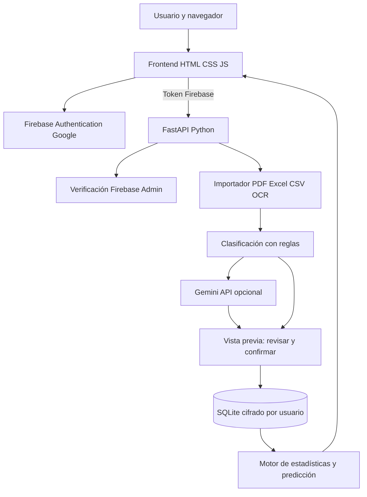
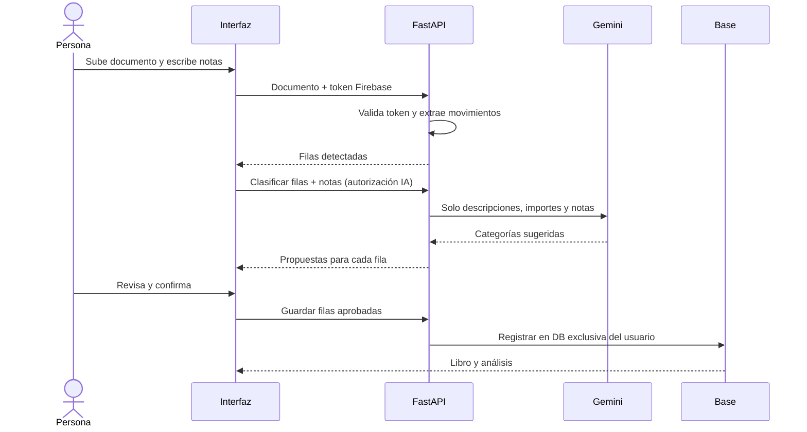

# Integral · Ingresos Variables

**Aplicación web de análisis de ingresos con notas personales, clasificación asistida por Gemini, estimaciones y registro histórico.** Las personas acceden con su cuenta de Google mediante Firebase Authentication. Los documentos y registros se mantienen separados por usuario en bases SQLite cifradas.

> **Estado:** el código y las pruebas locales están listos. Para utilizar Google y Gemini reales hace falta configurar credenciales propias. El despliegue a Internet no está hecho desde este repositorio: sigue los pasos de abajo. No uses documentación financiera real con un servidor sin HTTPS, copias de seguridad y acceso protegido.

## 1. Qué hace

1. Inicia sesión con Google.
2. Sube un archivo **PDF, CSV, XLSX, TXT o imagen** y escribe al mismo tiempo tus notas (por ejemplo, «la cuenta terminada en 1234 es mía, las cuotas de ajedrez son servicios y la maqueta fue un ingreso único»).
3. Integral extrae movimientos y utiliza reglas y, si se autoriza/configura, **Gemini** para proponer categorías en la **tabla de vista previa**. No envía el PDF completo a Gemini: envía descripciones, importes y notas para analizar. La IA puede equivocarse: revisa antes de confirmar.
4. Acepta o corrige las categorías; se guardan los datos en un registro personal con detección básica de duplicados.
5. Consulta el análisis mensual, trimestral o anual, predicciones conservadora/esperada/optimista y una sugerencia orientativa de ahorro.

Las categorías contemplan ingresos recurrentes, variables o extraordinarios; gastos, transferencias propias, reembolsos, préstamos y pendientes. Los movimientos dudosos no se cuentan automáticamente como ingresos. El reconocimiento de fotografías y PDFs escaneados necesita **Tesseract OCR**, y los formatos desconocidos pueden necesitar revisión manual.

## 2. Arquitectura





## 3. Herramientas y archivos

| Recurso | Uso |
|---|---|
| `app/main.py` + **FastAPI** | Endpoints `/api/*`, carga, revisión, aprobación, exportación y consultas. |
| `app/auth.py` + **firebase-admin** | Verifica los tokens de Google en el servidor. |
| `static/auth.js` + Firebase Web SDK | Botón Google, sesión y envío de token al backend. |
| `app/importer.py` + **PyMuPDF** | Lee PDF; usa **openpyxl** para Excel y **pytesseract/Pillow** para OCR de imágenes. |
| `app/classifier.py`, `app/ai.py` + **requests** | Reglas conservadoras y Gemini API; Gemini es opcional. No utiliza Ollama. |
| `app/core.py` | Cálculo determinístico de ingresos, periodos y predicciones. |
| `app/storage.py` + **sqlite3/cryptography** | SQLite por `uid` de Firebase y cifrado Fernet. |
| `static/index.html`, `static/app.js`, `static/style.css` | Interfaz, vista previa editable y gráficos. |
| `tests/` + **pytest/httpx** | Pruebas de API, importación, cálculo y separación por usuario. |

## 4. Crear una instalación desde cero (Windows)

1. Instala **Python 3.11 o superior**, marcando *Add Python to PATH*. Instala Git si usarás un repositorio.
2. Clona o descarga el proyecto:
   ```powershell
   git clone https://github.com/EmilyCurin/Integral-ingresos-variables.git
   cd Integral-ingresos-variables
   ```
3. Crea un entorno virtual e instala dependencias:
   ```powershell
   py -3 -m venv .venv
   .\.venv\Scripts\Activate.ps1
   python -m pip install -r requirements.txt
   ```
   Si PowerShell bloquea la activación, usa directamente `.\.venv\Scripts\python.exe` para los comandos.
4. Copia `.env.example` como `.env`:
   ```powershell
   Copy-Item .env.example .env
   ```
5. Genera una clave aleatoria y cópiala a `INTEGRAL_MASTER_KEY` dentro de `.env`:
   ```powershell
   python -c "import secrets;print(secrets.token_urlsafe(48))"
   ```
   **Conserva la clave**: cambiarla impedirá descifrar los datos anteriores. Nunca subas `.env` a GitHub.
6. Configura Firebase y credenciales del servidor en los pasos 5 y 6.
7. Arranca:
   ```powershell
   python -m uvicorn app.main:app --host 127.0.0.1 --port 8765
   ```
   Abre **http://localhost:8765**. También puedes iniciar con `INICIAR_WINDOWS.bat`.

**macOS/Linux:** `python3 -m venv .venv && source .venv/bin/activate && pip install -r requirements.txt`; luego el mismo comando `uvicorn`. Si vas a leer PDFs escaneados o fotografías, instala Tesseract OCR y asegúrate de que `tesseract` esté en el `PATH`.

## 5. Configurar Firebase para Google

1. En [Firebase Console](https://console.firebase.google.com/) abre el proyecto **`integral-18a66`** (o crea uno propio).
2. Ve a **Authentication → Sign-in method → Google**, activa el proveedor y guarda.
3. En **Authentication → Settings → Authorized domains**, agrega **`localhost`** y posteriormente el dominio de tu aplicación desplegada. No agregues dominios desconocidos.
4. Registra una **app web** desde Configuración del proyecto. Los datos públicos `apiKey`, `authDomain`, `projectId`, `appId`, etc. van en `static/auth.js` (este proyecto ya incluye la configuración web de `integral-18a66`). **La configuración web no es la credencial del servidor**.
5. Para validar tokens, el backend necesita credenciales **Firebase Admin**. En tu equipo puedes crear una cuenta de servicio siguiendo **Configuración del proyecto → Cuentas de servicio → Generar clave privada**; guarda el JSON **fuera de GitHub y fuera de la carpeta publicada**, y establece en `.env`:
   ```dotenv
   FIREBASE_PROJECT_ID=integral-18a66
   GOOGLE_APPLICATION_CREDENTIALS=C:/ruta/privada/firebase-admin.json
   ```
   Alternativamente, en un servidor de Google Cloud usa la identidad de servicio de la máquina. Nunca incluyas el JSON privado en el frontend.
6. Reinicia el servidor y abre la aplicación. La página mostrará **Continuar con Google**. Puedes registrar usuarios nuevos sin autorizarlos manualmente.

En el entorno local el token se verifica en el backend; sin credenciales de Firebase Admin, el inicio de sesión puede funcionar en el navegador, pero las solicitudes al servidor devolverán `401`. Esto es esperado hasta completar la configuración.

## 6. Configurar IA (opcional)

En [Google AI Studio](https://aistudio.google.com/) genera una clave de Gemini y colócala **solo en `.env` del backend**:

```dotenv
GEMINI_API_KEY=TU_CLAVE_PRIVADA
GEMINI_MODEL=gemini-2.5-flash
```

Al subir un documento, escribe las notas y mantén marcada la autorización de IA; la aplicación propondrá categorías automáticamente. Con Gemini deshabilitado o sin Internet, funcionan las reglas conservadoras, el historial y los cálculos. **El PDF completo no se envía a Gemini**, pero sí las descripciones bancarias y notas si habilitas la casilla; evita incluir identificadores sensibles en ellas.

## 7. Probar el funcionamiento

Primero ejecuta todas las pruebas automatizadas:

```powershell
python -m pytest -q
```

Luego realiza tres pruebas de usuario:

1. **Importación**: entra con Google, sube `examples/ingresos_ejemplo.csv` y verifica que aparezcan filas en revisión.
2. **Notas + IA**: escribe «Las clases son habituales; la maqueta fue un proyecto único», clasifica con IA (o reglas), revisa si las categorías cambian y confirma únicamente las correctas.
3. **Historial e independencia**: consulta el libro y los análisis, cierra sesión e ingresa con **otra cuenta de Google**. El segundo usuario no debe ver los datos del primero.

Los tests automatizados usan `INTEGRAL_DEV_AUTH=1` **solamente en el entorno de pruebas** para evitar depender de Google. No se trata de una opción de producción. La prueba real de inicio con Google y de Gemini requiere credenciales válidas y revisión manual.

## 8. Desplegarlo (frontend en Vercel, backend aparte)

**Vercel puede servir el frontend estático, pero el backend Python, SQLite y los documentos originales requieren un servicio persistente.** No despliegues simplemente el ZIP en Vercel esperando que SQLite sobreviva a reinicios de funciones serverless.

Opción práctica para una primera entrega: **Render/Railway con volumen persistente** sirve FastAPI y los archivos `static/` desde un mismo dominio. En el panel de ese servicio:

1. Conecta el repositorio GitHub, selecciona Python y ejecuta `pip install -r requirements.txt`.
2. Usa como comando de inicio `uvicorn app.main:app --host 0.0.0.0 --port $PORT`.
3. Configura `FIREBASE_PROJECT_ID`, `INTEGRAL_MASTER_KEY` y (si usarás Gemini) `GEMINI_API_KEY` como secretos del servicio. Añade credenciales de Firebase Admin de forma segura.
4. Monta un **disco persistente** y define `INCOME_DATA_DIR=/ruta/del/volumen/data`. Haz copias de seguridad seguras. Sin disco, los archivos pueden desaparecer al reiniciar.
5. Activa HTTPS y agrega el dominio generado a **Firebase Authorized domains**. Comprueba el inicio y cierre de sesión.
6. Verifica con dos navegadores que no se mezclen los historiales. Prueba el flujo de importación antes de permitir información bancaria real.

Si te exigen **Vercel**, publica allí **únicamente el frontend** después de adaptarlo para usar una URL de API externa, añadir CORS restringido y gestionar correctamente los dominios de autenticación. La variante de un solo dominio anterior es la más simple y ya usa el frontend existente sin cambios de rutas.

## 9. Seguridad y limitaciones

- Cada token Firebase se valida en FastAPI y cada `uid` usa una base SQLite propia; la información sensible de movimientos/notas/documentos se cifra mediante una clave derivada del secreto del servidor.
- **No hay migración automática** desde la antigua bóveda con contraseña; conserva una copia segura de `data/` de versiones anteriores. No subas esos archivos al repositorio.
- No pierdas `INTEGRAL_MASTER_KEY`: sin ella no podrás recuperar los registros cifrados. `data/` y los documentos deben permanecer fuera de Git.
- No hay cuentas de acceso por email/contraseña: la entrada es mediante proveedor **Google**; las sesiones y acceso entre usuarios deben verificarse en despliegue.
- No garantiza leer todo PDF o foto: OCR, formatos bancarios diferentes y notas ambiguas pueden requerir correcciones. Nunca asume sin confirmación que una transferencia es propia.
- Gemini usa una API de terceros y puede generar costes según la configuración de tu cuenta. Solo se invoca si lo habilitas y configuras.
- Las predicciones y ahorros son aproximaciones, **no asesoría financiera ni contabilidad fiscal**.

## 10. Copiar cambios a GitHub

```powershell
git status
git add .
git commit -m "Integrar Firebase Google y clasificacion con notas"
git pull origin main --no-rebase
git push origin main
```

Si aparece `CONFLICT`, resuélvelo antes de hacer push; no uses `--force`. Comprueba que `.env`, credenciales de servicio, documentos bancarios y `data/` no estén en los archivos preparados para commit (`git status`).


## Mejoras de interfaz: gastos, ingresos y plan

1. En **Importar**, adjunta un documento y añade observaciones por escrito o con **Dictar observaciones**. El dictado utiliza Web Speech API del navegador; requiere permiso de micrófono, un navegador compatible y puede depender del servicio de voz del proveedor. No está garantizado sin Internet. Revisa siempre la transcripción.
2. Revisa los colores de la tabla: gastos amarillos, préstamos rojos, ingresos recurrentes verdes, variables azules y extraordinarios morados; el color acompaña al texto, no lo sustituye. La categoría `pendiente` se reserva principalmente para abonos de origen dudoso, especialmente mayores a Q2,000.
3. Confirma la importación. Consulta las pestañas **Gastos**, **Ingresos** y **Plan**. En **Plan**, responde hasta tres preguntas sobre las categorías de mayor gasto y añade gastos fijos si quieres afinar el presupuesto.
4. Las categorías de gasto se estiman con reglas de palabras clave sobre la descripción bancaria y pueden equivocarse; el libro permite corregirlas. El plan aplica cálculos orientativos basados en transacciones confirmadas y respuestas; no calcula deudas externas ni garantiza disponibilidad real de ahorro.

Para probar las tres reglas incorporadas: `python -m pytest tests/test_improvements.py -q`. Para comprobar errores de JavaScript, con Node instalado: `node --check static/app.js`.

**Privacidad del dictado:** la Web Speech API puede procesar el audio con servicios del proveedor del navegador. Solicita consentimiento y evita dictar datos sensibles de terceros.
