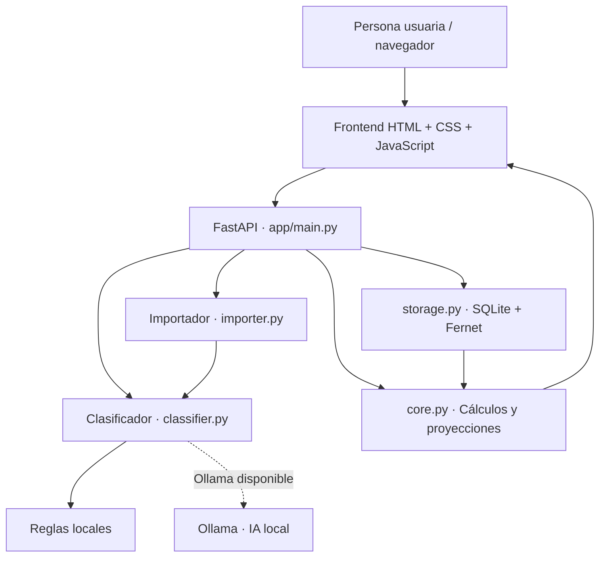
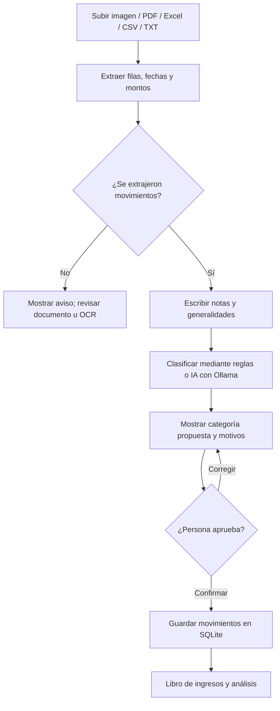

# Integral · Análisis inteligente de ingresos variables

**Integral** es una aplicación web que funciona en tu computadora para organizar ingresos variables a partir de estados de cuenta, fotografías, PDF, Excel, CSV o notas personales. Ayuda a distinguir **ingresos reales** de transferencias propias, gastos, reembolsos y depósitos de origen incierto, y presenta resúmenes y estimaciones de ingresos futuros.

> **Estado del proyecto:** prototipo funcional, no herramienta bancaria certificada. La lectura y clasificación de formatos desconocidos puede necesitar correcciones. Las propuestas de IA deben confirmarse antes de guardarse. No ofrece asesoría financiera.

## 1. Qué puedes hacer

- Importar documentos y **revisar los movimientos detectados** antes de incorporarlos al libro.
- Escribir generalidades como «estos pagos son de alumnos» o «esta cuenta también es mía» y solicitar una **preclasificación** de todos los movimientos importados.
- Clasificar los movimientos como **recurrente, variable, extraordinario, gasto, transferencia propia, reembolso, préstamo, excluir o pendiente**.
- Registrar o editar movimientos manualmente, guardar notas y consultar un **libro histórico**.
- Analizar un mes, tres meses, doce meses o todo el historial; generar escenarios de ingresos conservador, esperado y optimista y una sugerencia de ahorro basada en el presupuesto.
- Conservar los registros en una **base de datos local SQLite**, protegida con contraseña y cifrado parcial de datos sensibles.

## 2. Arquitectura y diagramas

No se exige una arquitectura Split Brain. El proyecto **separa cálculos tradicionales de la interpretación opcional de IA** para que los importes no dependan de respuestas generativas.



**Cómo se procesa un archivo:**



**Regla fundamental:** una entrada de dinero **no es necesariamente un ingreso**. Una transferencia entre cuentas propias, un préstamo o un reembolso no deben aumentar el cálculo de ingresos por servicios. Ante información insuficiente, se debe usar `pendiente` y pedir revisión.

## 3. Tecnologías y archivos del código

| Recurso | Función en Integral |
|---|---|
| **Python** | Lenguaje del backend y procesamiento financiero. |
| **FastAPI** (`app/main.py`) | API de carga, clasificación, guardado, análisis, acceso y exportación. |
| **Uvicorn** | Servidor web que ejecuta FastAPI en `127.0.0.1:8765`. |
| **python-multipart** | Permite recibir archivos desde el navegador. |
| **PyMuPDF** | Lee texto y posiciones de elementos en PDF; ayuda a distinguir columnas de débitos y créditos. |
| **openpyxl** | Lee libros de Excel `.xlsx`. |
| **Pillow, pytesseract y Tesseract** | Procesamiento y reconocimiento de texto (OCR) en fotografías o páginas escaneadas; **Tesseract se instala aparte**. |
| **requests** | Comunicación HTTP con Ollama instalado en la computadora. |
| **SQLite / `sqlite3`** (`app/storage.py`) | Almacén local de movimientos, notas y documentos opcionales. |
| **cryptography / Fernet** | Cifra contenidos sensibles usando una clave derivada de la contraseña. |
| **`app/importer.py`** | Reconoce formatos de archivo y propone transacciones. |
| **`app/classifier.py`** | Clasificación prudente por reglas; propuesta contextual por lotes usando Ollama. |
| **`app/ai.py`** | Genera interpretaciones textuales desde Ollama. |
| **`app/core.py`** | Totales, promedios, escenarios y referencia de ahorro. |
| **HTML, CSS y JavaScript** (`static/`) | Interfaz, vista previa, edición y confirmación de movimientos. |
| **pytest y httpx** (`tests/`) | Pruebas unitarias y de la API. |

### Organización de carpetas

```text
Integral-ingresos-variables/
├── README.md
├── requirements.txt
├── .env.example
├── .gitignore
├── INICIAR_WINDOWS.bat
├── INICIAR_MAC_LINUX.sh
├── app/
│   ├── main.py
│   ├── importer.py
│   ├── classifier.py
│   ├── ai.py
│   ├── core.py
│   └── storage.py
├── static/
│   ├── index.html
│   ├── app.js
│   └── style.css
├── examples/
│   └── ingresos_ejemplo.csv
├── tests/
│   └── ...
└── data/                 # Se crea al ejecutar; nunca se sube a GitHub
```

## 4. Construcción e instalación desde cero

### Requisitos

- **Windows 10/11**, con **Python 3.11 o 3.12** y el lanzador `py` disponible; para Mac/Linux hay script aparte.
- Internet para **instalar dependencias la primera vez**. Después, los cálculos y registros pueden funcionar localmente.
- Opcional: **Ollama** con el modelo `gemma3:4b` para interpretar contexto.
- Opcional: **Tesseract OCR** para imágenes y PDF escaneados.

### Windows · procedimiento recomendado

1. Clona el repositorio desde PowerShell, o descárgalo como ZIP y descomprímelo:

   ```powershell
   git clone https://github.com/EmilyCurin/Integral-ingresos-variables.git
   cd Integral-ingresos-variables
   ```

2. Ejecuta `INICIAR_WINDOWS.bat` desde el explorador. El script crea `.venv`, instala los paquetes de `requirements.txt` y levanta el servidor. **Mantén la consola abierta** mientras uses la aplicación.
3. Abre **http://127.0.0.1:8765**.
4. La primera vez, crea una **contraseña de al menos 10 caracteres**. Anótala en un gestor de contraseñas: no existe recuperación de la bóveda.
5. Importa `examples/ingresos_ejemplo.csv` para probar el sistema sin usar datos privados.

**Alternativa: instalar y arrancar paso a paso desde PowerShell**, si prefieres ver cada comando:

```powershell
py -3 -m venv .venv
.\.venv\Scripts\python.exe -m pip install -r requirements.txt
.\.venv\Scripts\python.exe -m uvicorn app.main:app --host 127.0.0.1 --port 8765
```

Para **Mac/Linux**, utiliza `bash INICIAR_MAC_LINUX.sh` y abre la misma dirección local; consulta el script para los requisitos de Python de tu sistema.

### Activar IA (opcional)

En otra terminal, con Ollama instalado:

```powershell
ollama pull gemma3:4b
ollama serve
```

Si Ollama ya está ejecutándose, no necesitas iniciar una segunda instancia. La aplicación utiliza por defecto `http://127.0.0.1:11434` y el modelo `gemma3:4b`. Es posible ajustar `OLLAMA_URL` y `OLLAMA_MODEL` como **variables de entorno del sistema antes de iniciar** Integral. El archivo `.env.example` sirve de referencia, **no se carga automáticamente** por el código actual.

### Activar lectura OCR (opcional)

Instala Tesseract OCR y asegúrate de que `tesseract` está en el `PATH`. En Windows también puedes definir la variable `TESSERACT_CMD` con la ruta del ejecutable. Los PDF con texto seleccionable pueden procesarse sin OCR.

## 5. Cómo usar Integral de principio a fin

1. Entra en **Importar**, selecciona el archivo y presiona **Leer y proponer movimientos**.
2. Revisa la vista previa. El sistema intenta encontrar fechas, descripciones, créditos y débitos sin exigir encabezados exactos. No garantiza reconocer cualquier formato.
3. Escribe las **generalidades** en el área correspondiente: por ejemplo, «Los pagos de ajedrez son alumnos habituales; el pago por maqueta fue único; las transferencias de mi otra cuenta no son ingresos».
4. Presiona **Clasificar movimientos con IA** (si Ollama está disponible), o utiliza las **reglas locales**. Se solicitan categorías y explicaciones para las filas detectadas.
5. Revisa la tabla resultante y corrige las filas dudosas. **Solo la confirmación de importación guarda los movimientos**. El programa evita ciertos duplicados comparando fecha, monto y descripción.
6. En **Resumen**, consulta los periodos y proyecciones; en **Libro de ingresos**, corrige o elimina registros. Puedes introducir un presupuesto para obtener una sugerencia general de ahorro.

**Estado real de la integración de IA:** existe una ruta que intenta actualizar las propuestas de clasificación en la tabla, pero **el funcionamiento de punta a punta con tu Ollama aún no está verificado**; en pruebas de uso se observó que la IA podía sugerir categorías sin reflejarlas correctamente. Si ocurre, revisa y ajusta manualmente. Nunca se debe asumir que una sugerencia quedó guardada solo porque apareció en pantalla.

## 6. Cómo calcula los resultados

- Suma como ingresos solamente las categorías `recurrente`, `variable` y `extraordinario`.
- Excluye de ingresos los `gasto`, `transferencia_propia`, `reembolso`, `prestamo`, `excluir` y `pendiente`.
- Utiliza la historia **sin ingresos extraordinarios** para aproximar el ingreso habitual.
- Presenta escenarios **conservador, esperado y optimista** utilizando estadísticas sencillas de los meses registrados; **no son predicciones garantizadas ni un modelo entrenado**.
- Si se proporciona un presupuesto, calcula una referencia de ahorro desde el margen estimado, no una evaluación completa de gastos o capacidad financiera.

## 7. Pruebas y validación

Desde la carpeta raíz:

```powershell
.\.venv\Scripts\python.exe -m pytest -q
```

Se incluyen pruebas de cálculos, almacenamiento, API, importación flexible y clasificación. También existe un **estado de cuenta sintético** en `tests/fixtures/` para probar el lector sin datos personales.

Para comprobar el sistema con un banco nuevo, verifica: **cantidad de filas, suma de créditos, suma de débitos, ausencia de duplicados, categorías y fechas**. Que el total de créditos coincida con el banco **no demuestra** que todos sean ingresos reales.

## 8. Privacidad y límites

- Los datos se guardan en `data/vault.db`. La contraseña protege el acceso y los campos sensibles y documentos almacenados están cifrados; **fechas, categorías y algunos metadatos no están cifrados**.
- La aplicación es **local y monousuario**. No publiques su servidor en Internet ni cambies `127.0.0.1` por una dirección abierta.
- **Nunca subas `data/`, documentos bancarios, exportaciones privadas o contraseñas a GitHub.** El `.gitignore` excluye `data/`.
- Los PDF con diseños desconocidos, documentos escaneados y hojas de cálculo poco estructuradas pueden requerir correcciones. El OCR puede equivocarse.
- La clasificación de Ollama depende del modelo, del tiempo de respuesta y de la claridad de la descripción: **un nombre o una transferencia no prueban por sí solos el origen del dinero**.

## 9. Próximos pasos

La mejora prioritaria es **verificar y robustecer la actualización automática de categorías en la vista previa**: subir documento → añadir notas → clasificar → revisar pocas excepciones → aceptar. Otras mejoras posibles son recordar clientes habituales confirmados, reconocer más bancos y mostrar confianza por movimiento.

---

**Para contribuir:** crea una rama, realiza cambios pequeños, ejecuta las pruebas y abre un pull request. Integral está orientado al aprendizaje y al análisis de ingresos personales, no a sustituir contabilidad profesional.
