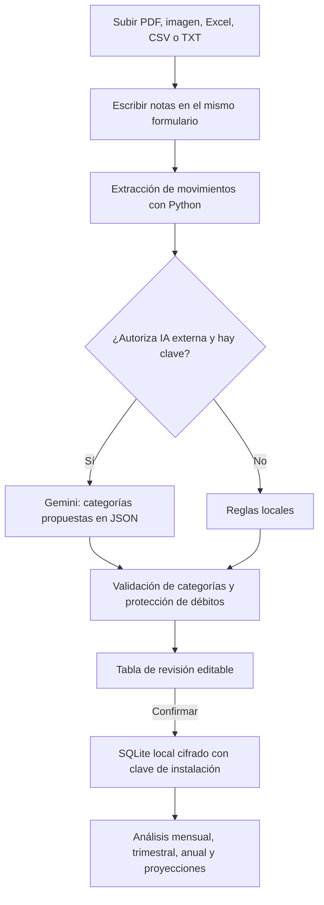
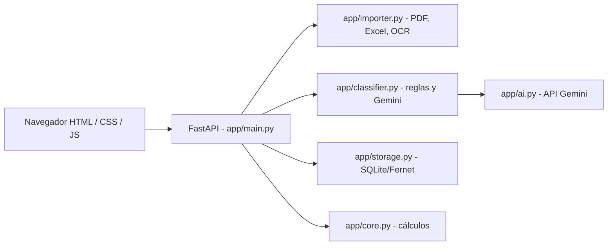

# Integral · Ingresos Variables

Prototipo web para interpretar estados de cuenta, CSV, Excel, imágenes y documentos con ingresos variables. Permite **cargar un documento y escribir notas en el mismo paso**, generar una preclasificación de ingresos/gastos con IA en la tabla, revisarla y confirmarla. Mantiene un libro local y genera análisis y escenarios de ingreso aproximado.

> **Estado (21 de octubre de 2026):** versión de desarrollo **local**. No se ha desplegado todavía como servicio multiusuario. No es asesoramiento contable ni financiero. Revisa las categorías antes de guardar.

## Cómo ejecutarlo

1. Instala **Python 3.11+**. Para fotos y PDF escaneados instala también **Tesseract OCR**, disponible por separado.
2. En Windows, descomprime y ejecuta `INICIAR_WINDOWS.bat`. La primera vez se crea `.venv` y se instalan dependencias.
3. Abre `http://127.0.0.1:8765` (el iniciador abre el navegador).
4. Para IA, copia `.env.example` a `.env` y configura `GEMINI_API_KEY` con una clave de acceso válida a Google Gemini. La clave se usa **solo en el backend** y no debe subirse a GitHub. Sin clave, Integral utiliza reglas locales, no IA.
5. Sube un documento, escribe tus notas **antes de analizar** y decide si autorizas enviar descripciones de transacciones y notas al servicio externo de IA. Tras analizar, corrige las excepciones en la tabla y confirma la importación.

### Comandos equivalentes

```bash
python -m venv .venv
# Windows: .venv\Scripts\activate
# macOS / Linux: source .venv/bin/activate
python -m pip install -r requirements.txt
python -m uvicorn app.main:app --host 127.0.0.1 --port 8765
```

Las imágenes requieren Tesseract, además de `pytesseract`. La primera ejecución sin Internet requiere tener dependencias ya instaladas.

## Funcionamiento





## Tecnologías y archivos

| Tecnología | Para qué se usa |
|---|---|
| FastAPI + Uvicorn | Backend HTTP y servidor local |
| PyMuPDF | Texto y posiciones de tablas en PDF |
| openpyxl | Lectura de archivos XLSX |
| Pillow + pytesseract | OCR de imágenes; requiere instalación externa de Tesseract |
| requests | Solicitudes a la API Gemini |
| SQLite (`sqlite3`) + cryptography/Fernet | Libro local y cifrado de campos/documentos |
| HTML, CSS, JavaScript | Vista de importación, tabla editable y panel financiero |
| pytest + httpx | Pruebas automáticas de importación, análisis, reglas y API |

El paquete contiene `app/` (backend), `static/` (interfaz), `tests/` (pruebas), `examples/` (datos ficticios) y los iniciadores Windows / macOS / Linux.

## Pruebas

```bash
python -m pytest -q
```

Las pruebas incluyen que un débito no sea reclasificado como ingreso, que las notas puedan influir en la clasificación simulando Gemini y que el importador gestione formatos flexibles. Para probar la IA *real* necesitas una clave de Gemini y conexión a Internet. **Las tres pruebas E2E con usuarios y el despliegue público siguen pendientes**, conforme a la propuesta de trabajo.

## Seguridad y limitaciones

- **Se eliminó el formulario de acceso con contraseña**, pero solamente para trabajar en `127.0.0.1` / `localhost`. El backend impide el uso de endpoints privados desde hosts públicos. **No desplegar directamente este servidor sin autenticación**.
- Los registros nuevos se cifran usando una clave generada y almacenada en `data/local.key`. Quien tenga acceso al equipo y a esa clave puede descifrarlos. No es un esquema de seguridad para múltiples usuarios.
- Si ya tienes una bóveda creada con la contraseña de una versión anterior, **no elimines ni sobrescribas `data/`**. La versión sin contraseña no puede descifrar automáticamente esos registros; conserva el ZIP anterior para acceder y exportarlos antes de migrar.
- La IA externa recibe notas y descripciones de movimientos, **no el PDF original**, cuando el usuario da su autorización. Revisa que no incluyan nombres completos, cuentas o datos que no quieras compartir. Puede equivocarse y las propuestas requieren confirmación.
- El importador no puede garantizar compatibilidad con todos los bancos o imágenes borrosas. Si los valores no cuadran con el estado de cuenta, corrige o rechaza la importación.
- El despliegue en Vercel/FastAPI y Firebase Google Auth requieren trabajo adicional, incluyendo aislamiento real por usuario y almacenamiento persistente. Una URL pública con la bóveda compartida sería insegura.

**Próximo entregable:** [Propuesta de trabajo](./PROPUESTA_TRABAJO_INTEGRAL.md) — despliegue seguro, tres E2E y tres pruebas con usuarios para el 28 de octubre.
